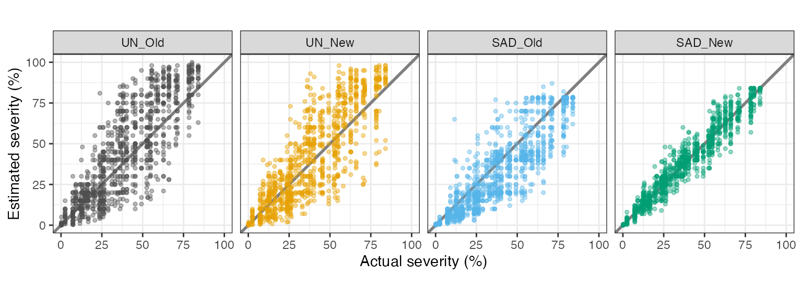
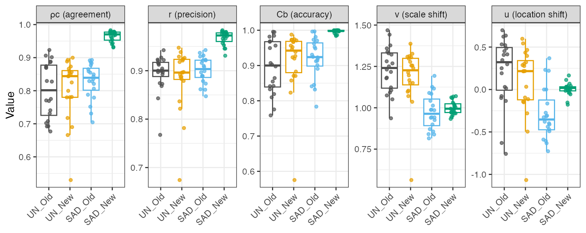
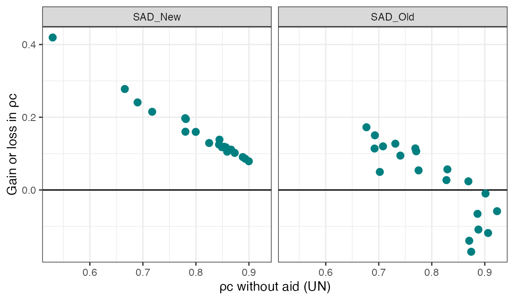
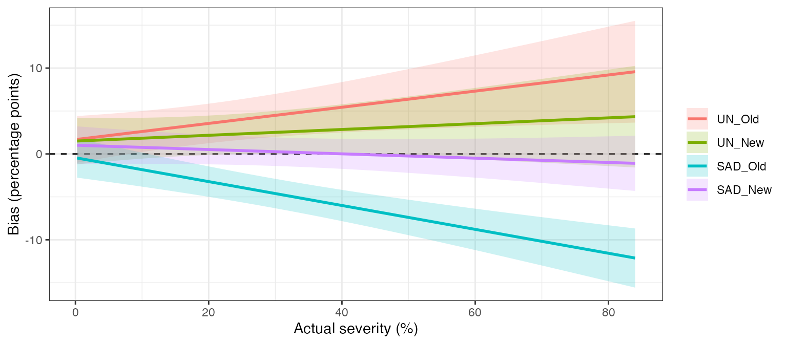
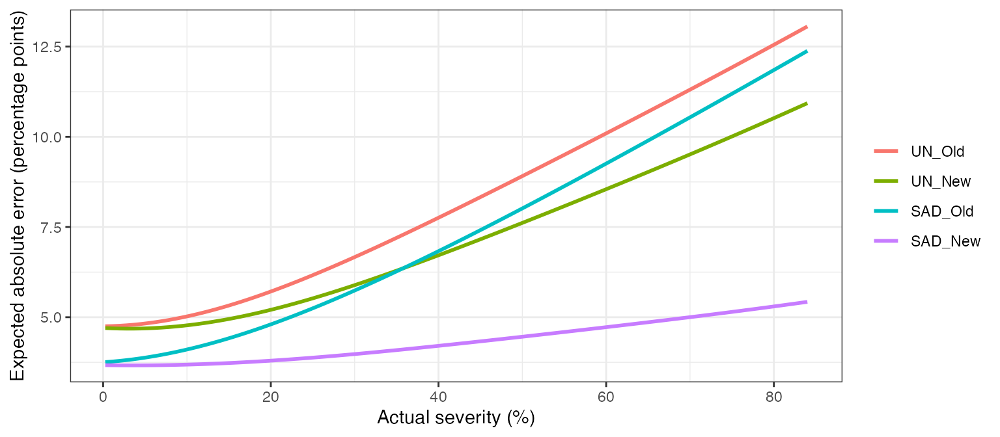
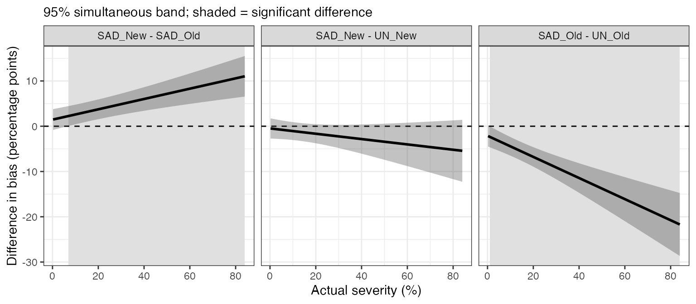
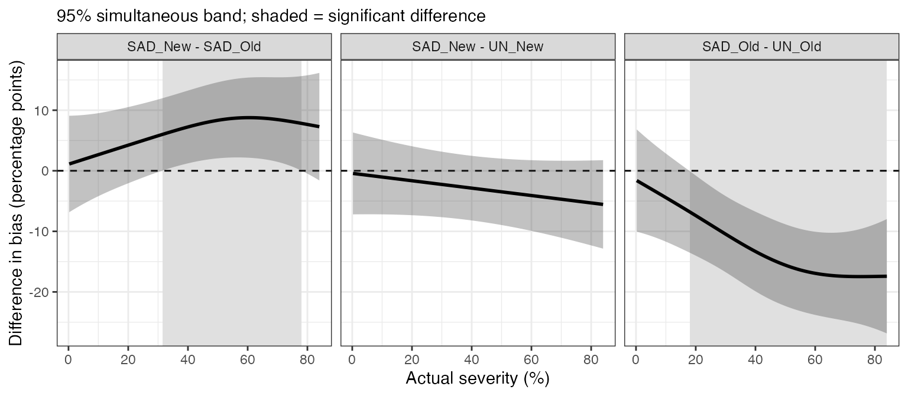
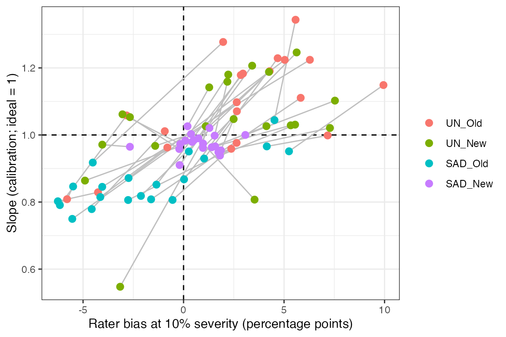

# Validation of standard area diagrams

## Introduction

Standard area diagrams (SADs) are sets of images of diseased organs with
known severity that raters consult while estimating severity by eye. A
new SAD is usually validated by asking a group of raters to assess the
same images without and then with the SAD, and comparing the accuracy of
the two sets of estimates.

This vignette walks through the workflow of the paper that proposed the
one-stage framework (Del Ponte et al., in preparation), step by step and
with the same functions, using one of the five studies reanalysed there.
Each section explains what a function does, what its output means and
how it was used in the paper. The workflow has two parts:

``` text
sad_data()                            1. organise and check the estimates
   │
   ├── conventional, two stages
   │     sad_ccc()                    2. Lin's statistics per rater and condition
   │     sad_compare()                3. means and Tukey letters by condition
   │     sad_reliability()            4. ICC and OCC among raters
   │     sad_plots()                  5. exploratory figures
   │
   └── one stage, hierarchical model
         sad_fit()                    6. mixed model of all estimates
         sad_curve(), sad_regions()   7. bias, variation and expected error along severity
         sad_curve(type = "smooth")   8. functional comparison (GAMM)
         sad_raters(), sad_images()   9. rater calibration and image difficulty
         sad_fit(dispersion, family) 10. sensitivity analyses
         sad_simulate()              11. planning a new study
```

## The example: soybean rust

`SADRustSoybean` comes from Franceschi et al. (2020). Forty raters
estimated the severity of soybean rust on 50 leaves, first without and
then with a SAD. Raters 1 to 20 used an old SAD and raters 21 to 40 a
new one. The design therefore compares two SADs between groups of
raters, each against its own unaided baseline. In the paper this is one
of the two studies with two SADs.

``` r

library(r4pde)
#> Registered S3 method overwritten by 'car':
#>   method           from
#>   na.action.merMod lme4
head(SADRustSoybean)
#>   sad rater leaf actual unaided aided
#> 1 Old     1    1   0.25       5   0.6
#> 2 Old     1    2   2.50      15   5.0
#> 3 Old     1    3   7.24      10   7.0
#> 4 Old     1    4   7.31      20  10.0
#> 5 Old     1    5   9.07      15  18.0
#> 6 Old     1    6  11.60      15   7.0
```

## 1. Preparing the data: `sad_data()`

[`sad_data()`](https://emdelponte.github.io/r4pde/reference/sad_data.md)
puts the estimates in long format, one row per rater, image and
condition, and checks them (missing values, estimates outside 0-100%,
raters who did not assess every image). The estimates here are in wide
format, one column per method, so `wide` names those columns and its
names become the method labels. `group` says which SAD each rater used,
so there are four conditions: `UN_Old`, `UN_New`, `SAD_Old` and
`SAD_New`.

``` r

x <- sad_data(SADRustSoybean, rater = "rater", image = "leaf", actual = "actual",
              wide = c(UN = "unaided", SAD = "aided"), group = "sad")
x
#> SAD validation data (paired design): 40 raters, 50 images, 4000 estimates
#> Conditions: UN_Old, UN_New, SAD_Old, SAD_New 
#> # A tibble: 4,000 × 8
#>    rater image actual estimate method group condition  error
#>    <fct> <fct>  <dbl>    <dbl> <fct>  <fct> <fct>      <dbl>
#>  1 1     1       0.25      5   UN     Old   UN_Old     4.75 
#>  2 1     1       0.25      0.6 SAD    Old   SAD_Old    0.35 
#>  3 1     2       2.5      15   UN     Old   UN_Old    12.5  
#>  4 1     2       2.5       5   SAD    Old   SAD_Old    2.5  
#>  5 1     3       7.24     10   UN     Old   UN_Old     2.76 
#>  6 1     3       7.24      7   SAD    Old   SAD_Old   -0.240
#>  7 1     4       7.31     20   UN     Old   UN_Old    12.7  
#>  8 1     4       7.31     10   SAD    Old   SAD_Old    2.69 
#>  9 1     5       9.07     15   UN     Old   UN_Old     5.93 
#> 10 1     5       9.07     18   SAD    Old   SAD_Old    8.93 
#> # ℹ 3,990 more rows
```

Data already in long format are passed with `estimate` and `method`
instead of `wide`. This is how the five studies of the paper were read:

``` r

sad_data(d, rater = "rater", image = "image", actual = "actual",
         estimate = "estimate", method = "method", group = "group")
```

For a study with a single SAD, `group` is left out:

``` r

x_new <- sad_data(subset(SADRustSoybean, sad == "New"),
                  wide = c(UN = "unaided", SAD = "aided"))
levels(x_new$condition)
#> [1] "UN"  "SAD"
```

## Part 1. The conventional two-stage analysis

The conventional analysis first summarises each rater under each
condition by one number per statistic (stage 1), then compares the means
of these numbers between conditions (stage 2). The paper keeps this
analysis because it is how SADs have been validated so far, and the
one-stage results are read against it.

### 2. Lin’s concordance per rater: `sad_ccc()`

For each rater and condition,
[`sad_ccc()`](https://emdelponte.github.io/r4pde/reference/sad_ccc.md)
computes Lin’s concordance correlation coefficient, \\\rho_c = r \cdot
C_b\\, and its components:

- \\r\\, Pearson’s correlation, measures **precision**;
- \\C_b = 2 / (v + 1/v + u^2)\\, the bias correction factor, measures
  **accuracy** and combines two shifts;
- \\v = \sigma_Y / \sigma_T\\, the **scale shift** (1 when the spread of
  the estimates matches the spread of the actual values);
- \\u = (\mu_Y - \mu_T) / \sqrt{\sigma_Y \sigma_T}\\, the **location
  shift**, negative when the rater underestimates.

``` r

cc <- sad_ccc(x)
head(cc)
#> # A tibble: 6 × 12
#>   rater group method condition     n rho_c     r    Cb     v       u intercept
#>   <fct> <fct> <fct>  <fct>     <int> <dbl> <dbl> <dbl> <dbl>   <dbl>     <dbl>
#> 1 1     Old   UN     UN_Old       50 0.901 0.942 0.956  1.05  0.297      7.22 
#> 2 2     Old   UN     UN_Old       50 0.906 0.923 0.982  1.18 -0.0998    -5.85 
#> 3 3     Old   UN     UN_Old       50 0.829 0.915 0.907  1.34  0.346      0.259
#> 4 4     Old   UN     UN_Old       50 0.923 0.927 0.996  1.09  0.0301     0.211
#> 5 5     Old   UN     UN_Old       50 0.771 0.916 0.841  1.36  0.531      4.35 
#> 6 6     Old   UN     UN_Old       50 0.869 0.897 0.969  1.18  0.191      2.31 
#> # ℹ 1 more variable: slope <dbl>
```

### 3. Comparing conditions: `sad_compare()`

The second stage compares the means of each statistic between
conditions. Because the same raters assessed the images without and with
the SAD, the means are compared with a mixed model with rater as random
intercept
([`lmerTest::lmer()`](https://rdrr.io/pkg/lmerTest/man/lmer.html)),
followed by Tukey’s test (`emmeans`). Means followed by the same letter
do not differ, and “a” marks the highest mean. These are the soybean
rows of Table 1 of the paper, and they match Table 2 of Franceschi et
al. (2020).

``` r

cmp <- sad_compare(x, cc)
cmp
#> Lin's statistics by condition - linear mixed model, rater random 
#> Means followed by the same letter do not differ (tukey, alpha = 0.05).
#> 
#>  condition  N       u      v     Cb      r  rho_c
#>     UN_Old 20  0.21 a 1.23 a 0.90 b 0.89 b 0.80 b
#>     UN_New 20  0.10 a 1.19 a 0.91 b 0.88 b 0.80 b
#>    SAD_Old 20 -0.29 b 0.97 b 0.92 b 0.90 b 0.83 b
#>    SAD_New 20  0.00 a 1.00 b 1.00 a 0.97 a 0.96 a
```

Only the new SAD improved \\\rho_c\\ significantly (0.96, against 0.83
with the old SAD and 0.80 without aid). The old SAD did change \\u\\,
which became negative, a sign of underestimation. The conventional
analysis stops here: it cannot say whether that underestimation is
constant or grows with severity.

### 4. Inter-rater reliability: `sad_reliability()`

[`sad_reliability()`](https://emdelponte.github.io/r4pde/reference/sad_reliability.md)
gives, for each condition, the two-way random-effects,
absolute-agreement, single-rater intraclass correlation coefficient
(ICC(A,1), McGraw and Wong 1996) and the overall concordance correlation
coefficient (OCC, Barnhart et al. 2002).

``` r

sad_reliability(x)
#> # A tibble: 4 × 7
#>   condition   ICC ICC_lower ICC_upper   OCC n_raters n_images
#>   <fct>     <dbl>     <dbl>     <dbl> <dbl>    <int>    <int>
#> 1 UN_Old    0.749     0.650     0.833 0.747       20       50
#> 2 UN_New    0.739     0.644     0.823 0.736       20       50
#> 3 SAD_Old   0.762     0.673     0.840 0.760       20       50
#> 4 SAD_New   0.942     0.918     0.962 0.941       20       50
```

### 5. Exploratory plots: `sad_plots()`

[`sad_plots()`](https://emdelponte.github.io/r4pde/reference/sad_plots.md)
returns a list of ggplot objects: estimates against actual severity,
boxplots of each Lin statistic, and the gain in \\\rho_c\\ of each rater
against the rater’s unaided \\\rho_c\\.

``` r

p <- sad_plots(x, cc, baseline = "UN")
p$scatter
```



``` r

p$box_ccc
```



``` r

p$gain_vs_baseline
```



The new SAD improved agreement for every rater, while the old SAD helped
some raters and made others worse.

## Part 2. The one-stage hierarchical model

The two-stage analysis reduces 50 estimates per rater to one number per
statistic. It cannot say at which severity a SAD helps or hurts, it
mixes bias, calibration and precision in \\\rho_c\\, and it ignores that
some images are hard for every rater. Looking at the components \\r\\,
\\v\\ and \\u\\ does not solve this, because they are also one number
per rater, averaged over the severity range. The one-stage model uses
every estimate.

### 6. Fitting the model: `sad_fit()`

Let \\y\_{ijc}\\ be the estimate of rater \\j\\ for image \\i\\ under
condition \\c\\, and \\z_i = (a_i - 10)/10\\ the actual severity
\\a_i\\, centred at 10% and in units of 10 percentage points (p.p.). The
model is

\\y\_{ijc} = (\beta\_{0c} + b\_{0jm}) + (\beta\_{1c} + b\_{1jm})\\ z_i +
v_i + w\_{ic} + \varepsilon\_{ijc}\\

- \\\beta\_{0c}\\ and \\\beta\_{1c}\\ are the mean estimate at 10%
  severity and the **calibration slope** of condition \\c\\ (a slope of
  1 is perfect calibration);
- \\b\_{0jm}\\ and \\b\_{1jm}\\ are the intercept and slope of rater
  \\j\\ under method \\m\\, so each rater can respond differently to the
  SAD;
- \\v_i\\ is the **difficulty** of image \\i\\, shared by all raters;
- \\w\_{ic}\\ is an image by condition effect;
- \\\varepsilon\_{ijc}\\ is the residual error, whose variance changes
  with severity and condition (`dispersion = "quad"`: log SD quadratic
  in \\z\\).

The rater effects matter most. The simulation in the paper showed that a
simpler model, with the same rater effects with and without the SAD,
attributes individual changes to the SAD and has a type I error near
35%.

Rich random-effects structures do not always converge, so
`structure = "auto"` (the default) tries four nested structures in order
and keeps the first with a positive definite Hessian and finite standard
errors: `"full"` (as above), `"noim"` (without \\w\_{ic}\\), `"sep"`
(rater intercepts and slopes uncorrelated) and `"base"` (rater effects
common to all methods). Under `"base"` the model cannot say whether the
SAD changed the variation among raters, so report which structure was
retained.

``` r

fit <- sad_fit(x)
#> Structure 'full' did not converge; trying the next one.
#> Structure 'noim' did not converge; trying the next one.
fit
#> One-stage model for SAD validation
#>   family: gaussian | dispersion: quad | rater structure: sep
#>   severity centred at 10%, in units of 10 percentage points
#>   40 raters, 50 images, 4000 estimates; conditions: UN_Old, UN_New, SAD_Old, SAD_New
#>   AIC = 28896.6
```

For soybean rust the `"sep"` structure was retained, as in the paper.
`summary(fit)` shows the full `glmmTMB` output: fixed effects, variance
components and dispersion coefficients.

``` r

summary(fit)
#>  Family: gaussian  ( identity )
#> Formula:          
#> y ~ z * condition + (0 + method | rater) + (0 + method:z | rater) +  
#>     (1 | image)
#> Dispersion:         ~condition * (z + I(z^2))
#> Data: d
#> 
#>       AIC       BIC    logLik -2*log(L)  df.resid 
#>   28896.6   29066.5  -14421.3   28842.6      3973 
#> 
#> Random effects:
#> 
#> Conditional model:
#>  Groups   Name        Variance Std.Dev. Corr 
#>  rater    methodUN    16.2052  4.0256        
#>           methodSAD    7.4892  2.7366   0.60 
#>  rater.1  methodUN:z   2.4365  1.5609        
#>           methodSAD:z  0.4169  0.6457   0.22 
#>  image    (Intercept) 10.2669  3.2042        
#>  Residual                  NA      NA        
#> Number of obs: 4000, groups:  rater, 40; image, 50
#> 
#> Conditional model:
#>                    Estimate Std. Error z value Pr(>|z|)    
#> (Intercept)         12.6128     1.2171  10.363  < 2e-16 ***
#> z                   10.9410     0.4220  25.928  < 2e-16 ***
#> conditionUN_New     -0.7780     1.3560  -0.574  0.56614    
#> conditionSAD_Old    -4.4436     0.8529  -5.210 1.89e-07 ***
#> conditionSAD_New    -1.8476     1.1514  -1.605  0.10856    
#> z:conditionUN_New   -0.6026     0.5220  -1.154  0.24834    
#> z:conditionSAD_Old  -2.3320     0.3863  -6.037 1.57e-09 ***
#> z:conditionSAD_New  -1.1920     0.4013  -2.970  0.00297 ** 
#> ---
#> Signif. codes:  0 '***' 0.001 '**' 0.01 '*' 0.05 '.' 0.1 ' ' 1
#> 
#> Dispersion model:
#>                           Estimate Std. Error z value Pr(>|z|)    
#> (Intercept)              1.8084620  0.0497085   36.38  < 2e-16 ***
#> conditionUN_New         -0.0291736  0.0672255   -0.43  0.66431    
#> conditionSAD_Old        -0.1427578  0.0683081   -2.09  0.03663 *  
#> conditionSAD_New        -0.7075876  0.0720512   -9.82  < 2e-16 ***
#> z                        0.4502573  0.0388648   11.59  < 2e-16 ***
#> I(z^2)                  -0.0542791  0.0059719   -9.09  < 2e-16 ***
#> conditionUN_New:z        0.0038985  0.0498339    0.08  0.93765    
#> conditionSAD_Old:z      -0.1381304  0.0539380   -2.56  0.01044 *  
#> conditionSAD_New:z      -0.0722728  0.0545600   -1.32  0.18529    
#> conditionUN_New:I(z^2)  -0.0002296  0.0075024   -0.03  0.97558    
#> conditionSAD_Old:I(z^2)  0.0235635  0.0083257    2.83  0.00465 ** 
#> conditionSAD_New:I(z^2)  0.0103912  0.0081300    1.28  0.20120    
#> ---
#> Signif. codes:  0 '***' 0.001 '**' 0.01 '*' 0.05 '.' 0.1 ' ' 1
```

### 7. Curves along the severity range: `sad_curve()` and `sad_regions()`

[`sad_curve()`](https://emdelponte.github.io/r4pde/reference/sad_curve.md)
turns the fitted model into curves over a grid of severities within the
observed range of each condition:

- **`bias`**, \\\beta\_{0c} + \beta\_{1c} z - a\\, with pointwise 95%
  confidence intervals;
- **`sd_rater`**, the standard deviation among raters, from the
  covariance of rater intercepts and slopes of the method;
- **`sd_image`** and **`sd_resid`**, the image and residual standard
  deviations;
- **`expected_abs_error`** (EAE), the expected absolute error of one
  estimate made by a new rater on a new image. It combines bias and all
  variance components (the mean of a folded normal distribution) and is
  in percentage points, so it can be compared directly with the accuracy
  a user needs.

Differences between pairs of conditions are computed over the common
severity range with 95% **simultaneous** confidence bands (from the
maximum absolute \\t\\ statistic over the grid), so a difference can be
read anywhere along the curve without inflating the error rate.

`reference = "UN"` compares each SAD with the unaided estimates of the
same raters. In the paper, `pairs` was used instead, to add the
comparison of the two SADs (New minus Old):

``` r

pairs <- data.frame(a = c("SAD_Old", "SAD_New", "SAD_New"),
                    b = c("UN_Old",  "UN_New",  "SAD_Old"))
cv <- sad_curve(fit, pairs = pairs)
```

[`sad_regions()`](https://emdelponte.github.io/r4pde/reference/sad_regions.md)
lists the severity ranges where each difference is significant, and its
direction:

``` r

sad_regions(cv)
#> # A tibble: 2 × 4
#>   contrast           from    to direction
#>   <chr>             <dbl> <dbl> <chr>    
#> 1 SAD_Old - UN_Old   1.10    84 a < b    
#> 2 SAD_New - SAD_Old  7.02    84 a > b
```

The curves are stored in `cv$curves`. Table 2 of the paper reports them
at selected severities, which takes a few lines:

``` r

at <- c(10, 20, 50, 75)
tab <- do.call(rbind, lapply(split(cv$curves, cv$curves$condition), function(z)
  data.frame(condition = z$condition[1], severity = at,
             bias = round(approx(z$actual, z$bias, at)$y, 1),
             EAE = round(approx(z$actual, z$expected_abs_error, at)$y, 1))))
tab[!is.na(tab$bias), ]
#>           condition severity  bias  EAE
#> UN_Old.1     UN_Old       10   2.6  5.0
#> UN_Old.2     UN_Old       20   3.6  5.7
#> UN_Old.3     UN_Old       50   6.4  8.9
#> UN_Old.4     UN_Old       75   8.7 11.9
#> UN_New.1     UN_New       10   1.8  4.8
#> UN_New.2     UN_New       20   2.2  5.2
#> UN_New.3     UN_New       50   3.2  7.6
#> UN_New.4     UN_New       75   4.0 10.0
#> SAD_Old.1   SAD_Old       10  -1.8  4.1
#> SAD_Old.2   SAD_Old       20  -3.2  4.8
#> SAD_Old.3   SAD_Old       50  -7.4  8.0
#> SAD_Old.4   SAD_Old       75 -10.9 11.2
#> SAD_New.1   SAD_New       10   0.8  3.7
#> SAD_New.2   SAD_New       20   0.5  3.8
#> SAD_New.3   SAD_New       50  -0.2  4.5
#> SAD_New.4   SAD_New       75  -0.9  5.1
```

The plot method draws the bias, the EAE or the differences:

``` r

plot(cv, "bias")
```



``` r

plot(cv, "expected_abs_error")
```



``` r

plot(cv, "difference")
```



The curves tell a different story for each SAD. The old SAD shifted
estimates downwards, and the shift grew with severity, from about -2
p.p. at 10% to about -7 p.p. at 50%. The new SAD did not change the bias
significantly anywhere in the range; its benefit was precision, which
shows in the EAE at 50% severity (about 4.5 p.p. with the new SAD,
against 8 p.p. with the old one).

### 8. A functional model for the error curves: `sad_curve(type = "smooth")`

The linear model assumes a straight bias line in each condition. With
`type = "smooth"`,
[`sad_curve()`](https://emdelponte.github.io/r4pde/reference/sad_curve.md)
fits a generalised additive mixed model (GAMM,
[`mgcv::bam()`](https://rdrr.io/pkg/mgcv/man/bam.html)) to the errors
\\y\_{ijc} - a_i\\: a smooth function of actual severity for each
condition, a random smooth curve for each rater by condition, and a
random image effect. Differences between conditions get simultaneous
bands in the same way.

``` r

cs <- sad_curve(fit, type = "smooth", pairs = pairs)
sad_regions(cs)
#> # A tibble: 2 × 4
#>   contrast           from    to direction
#>   <chr>             <dbl> <dbl> <chr>    
#> 1 SAD_Old - UN_Old   18.0  84   a < b    
#> 2 SAD_New - SAD_Old  31.6  78.1 a > b
plot(cs, "difference")
```



In the paper, the linear model found the new SAD less negatively biased
than the old one from 7% severity upwards, and the GAMM only from 31%
upwards. When the two models disagree, report both and give more weight
to effects found by both.

### 9. Raters and images: `sad_raters()`, `plot_sad_raters()`, `sad_images()`

[`sad_raters()`](https://emdelponte.github.io/r4pde/reference/sad_raters.md)
returns, for each rater and condition, the predicted bias at 10%
severity and the calibration slope (best linear unbiased predictors).
The plot links the same rater across conditions; it is Figure 3 of the
paper.

``` r

rt <- sad_raters(fit)
plot_sad_raters(rt)
```



With the new SAD, most raters moved close to no bias and to a slope of
one; with the old SAD, many moved to underestimation with slopes below
one.

[`sad_images()`](https://emdelponte.github.io/r4pde/reference/sad_images.md)
returns the difficulty of each image, the amount by which all raters
tended to over- or underestimate it, sorted from the largest absolute
value. Images at the top deserve a second look, for instance to check
the actual severity measured by image analysis.

``` r

head(sad_images(fit))
#> # A tibble: 6 × 4
#>   image actual difficulty    se
#>   <chr>  <dbl>      <dbl> <dbl>
#> 1 38      55.5       9.23 1.23 
#> 2 41      62.7       5.64 1.23 
#> 3 35      53.1      -5.52 1.20 
#> 4 25      36.7       5.37 1.07 
#> 5 14      23.6      -5.27 0.936
#> 6 17      25.8       4.83 0.944
```

### 10. Sensitivity analyses

The paper checked two assumptions of the model with arguments of
[`sad_fit()`](https://emdelponte.github.io/r4pde/reference/sad_fit.md).

**Residual variance.** Severity is bounded at 0 and 100%, so errors are
necessarily smaller near the bounds. The default quadratic dispersion
allows the residual variance to peak at intermediate severity. It can be
compared with a log-linear dispersion, keeping the same random-effects
structure, by AIC:

``` r

fit_lin <- tryCatch(
  sad_fit(x, structure = fit$structure, dispersion = "lin"),
  error = function(e) NULL
)
if (!is.null(fit_lin)) {
  AIC(fit$model, fit_lin$model)
} else {
  message("The log-linear dispersion model did not converge on this system.")
}
#>               df      AIC
#> fit$model     27 28896.59
#> fit_lin$model 23 29175.60
```

The quadratic dispersion fitted better in all five studies of the paper.

**Bounded response.** `family = "ordbeta"` refits the model as an
ordered beta regression on the proportion scale, which accepts exact
zeros and ones. The fixed effects are on the logit scale, so the check
is whether the conclusions about the SAD effects stay the same, not
whether the numbers match. The fit takes a few minutes, so it is not run
here.

``` r

fit_ob <- sad_fit(x, family = "ordbeta", dispersion = "lin")
summary(fit_ob)
```

In the paper the ordered beta model supported the main conclusions: in
soybean it shifted the mean downwards with the old SAD but not with the
new one.

### 11. Planning a new study: `sad_simulate()`

How many raters a validation study needs depends on its question. To
estimate mean agreement precisely and test its gain with the SAD, use
the precision and power criteria for \\\rho_c\\ of Romero-Benavides et
al. (2026b), also available in their Shiny application.
Severity-dependent effects need more information, and
[`sad_simulate()`](https://emdelponte.github.io/r4pde/reference/sad_simulate.md)
checks whether a design is enough for them.

[`sad_simulate()`](https://emdelponte.github.io/r4pde/reference/sad_simulate.md)
generates paired studies (each rater assesses the same images without
and then with the SAD) and returns, for each number of raters and
images, the rejection rate at 5% of the paired \\t\\ test on \\\rho_c\\
and of the likelihood ratio test of the one-stage model. The SAD effect
is set with `shift` (change in bias at 10% severity, in p.p.),
`slope_change` (change in calibration slope) and `precision` (multiplier
of the rater and residual SDs). The other parameters default to values
typical of published studies. With `shift = 0`, `slope_change = 0` and
`precision = 1`, the rejection rate is the type I error.

Each scenario fits many models, so the calls below are not run. The
first simulates a constant shift of -3 p.p.; the second a SAD that only
changes calibration, two of the scenarios of the paper.

``` r

sad_simulate(n_rater = c(10, 20, 40), n_image = c(20, 40), nsim = 200,
             shift = -3, cores = 4)
sad_simulate(n_rater = c(10, 20, 40), n_image = c(20, 40), nsim = 200,
             shift = 0, slope_change = -0.10, cores = 4)
```

In the paper, the paired \\t\\ test detected a precision effect well but
detected a constant shift in only 16% of the studies and a
calibration-only effect in 7%; the one-stage test reached 77% and 53%
with 40 raters. With 10 raters its type I error was 0.13, so a
parametric bootstrap of the likelihood ratio is advisable in small
studies.

## What to report

From the conventional analysis, the table of
[`sad_compare()`](https://emdelponte.github.io/r4pde/reference/sad_compare.md)
and the reliability coefficients, so that results can be compared with
earlier studies. From the one-stage model, the random-effects structure
retained, the bias curves with simultaneous bands and the regions where
conditions differ, the EAE at a few severities of practical interest,
and the rater plot. The code for all five studies of the paper is in its
research compendium \[GitHub repository to be added\].

## References

Barnhart, H. X., Haber, M., and Song, J. (2002). Overall concordance
correlation coefficient for evaluating agreement among multiple
observers. Biometrics 58:1020-1027.

Del Ponte, E. M., et al. (in preparation). Beyond Lin’s concordance: a
one-stage hierarchical framework for validating standard area diagrams
for plant disease severity.

Franceschi, V. T., Alves, K. S., Mazaro, S. M., Godoy, C. V., Duarte, H.
S. S., and Del Ponte, E. M. (2020). A new standard area diagram set for
assessment of severity of soybean rust improves accuracy of estimates
and optimizes resource use. Plant Pathology 69:495-505.

Lin, L. I. (1989). A concordance correlation coefficient to evaluate
reproducibility. Biometrics 45:255-268.

McGraw, K. O., and Wong, S. P. (1996). Forming inferences about some
intraclass correlation coefficients. Psychological Methods 1:30-46.

Romero-Benavides, M. P., Bock, C. H., Tomáz, R. G., Nunes, W. C., and
Del Ponte, E. M. (2026b). Integrating precision and power criteria in
determining the number of raters needed for standard area diagram
validation studies. European Journal of Plant Pathology, in press.
